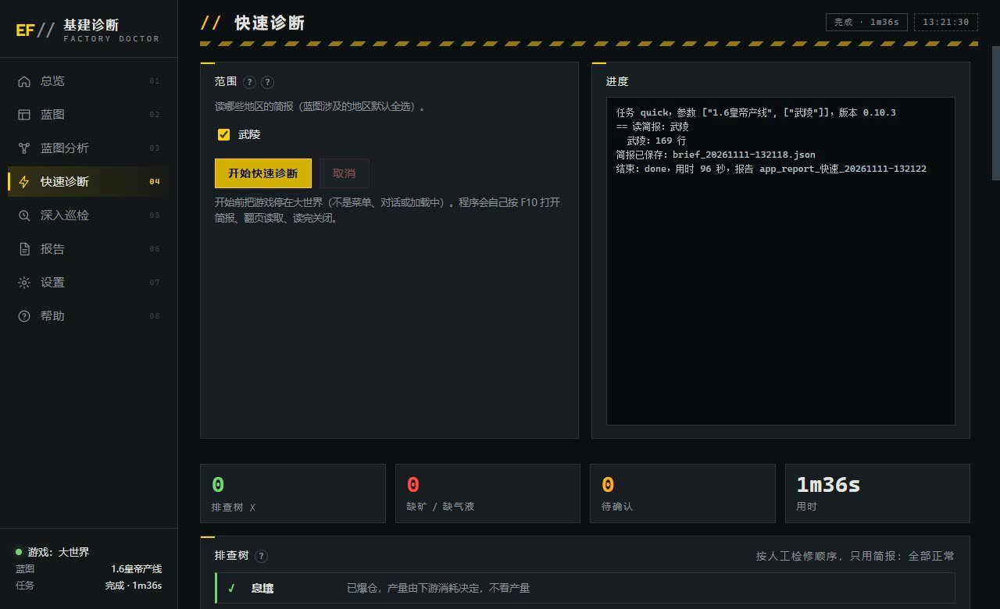
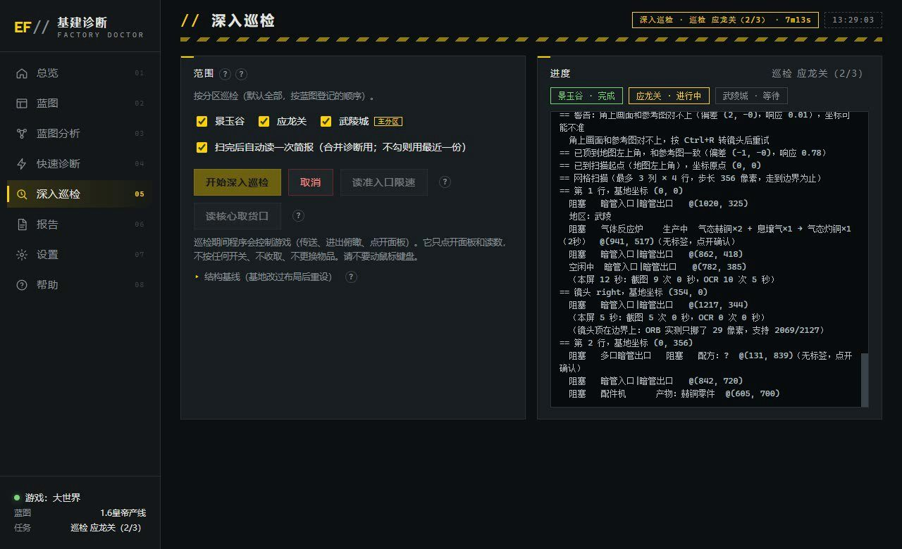
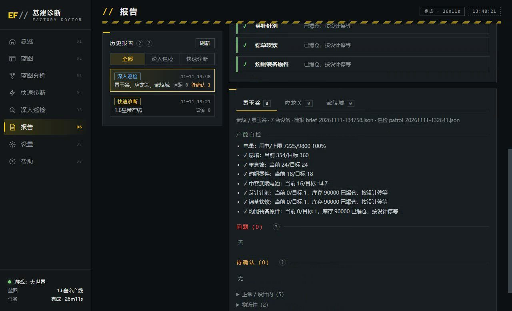
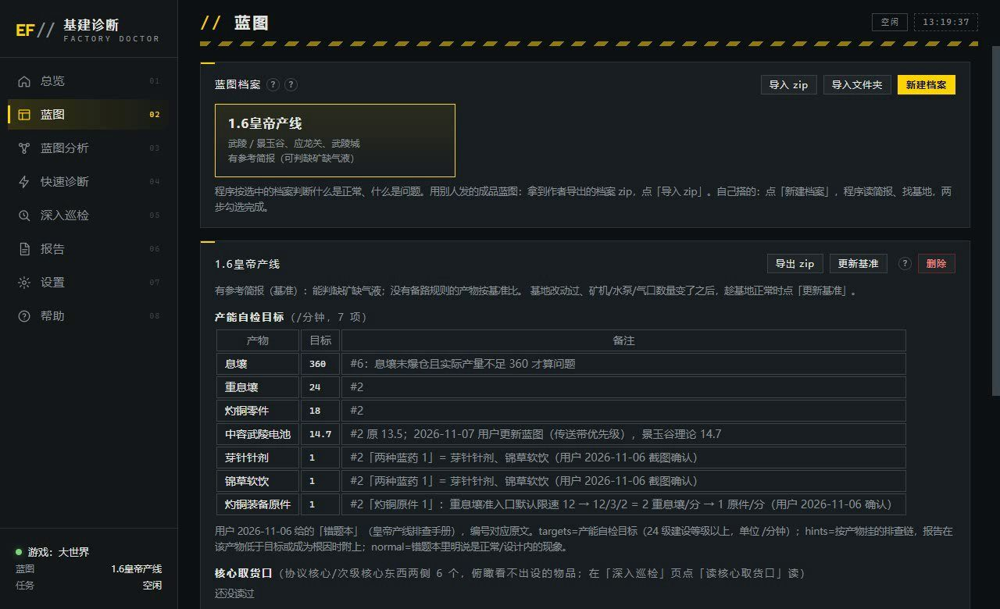

# Endfield Doctor · 终末地基建诊断

帮《明日方舟：终末地》玩家检查基建产线哪里出了问题的 Windows 小工具。
A Windows tool that finds what's wrong with your Arknights: Endfield factory.


产线一大，哪台设备断了料、哪根管子被拆了、哪个准入口被改了，靠肉眼一台台点开看很费时间。
这个工具会替你翻游戏里的简报，和蓝图应有的产量对一遍，按人工排查的顺序告诉你哪里不对、该去哪个分区看哪类设备；
需要的话还能自己传送过去，进俯瞰把有异常标记的设备挨个点开核对，最后给出一份带依据和建议的报告。

目前支持 1.6「皇帝产线」蓝图（武陵：景玉谷、应龙关、武陵城）。

## 目录

- [功能](#功能)
- [截图](#截图)
- [运行环境](#运行环境)
- [下载与使用](#下载与使用)
- [常见问题](#常见问题)
- [数据与隐私](#数据与隐私)
- [反馈](#反馈)
- [本地开发](#本地开发)
- [致谢](#致谢)
- [免责声明](#免责声明)
- [许可证](#许可证)

## 功能

### 快速诊断

- 自己按 F10 打开简报，逐页读完各物品的当前和理论产耗，大约 2 分钟
- 按人工检修的顺序列出「排查树」：电量、息壤、灼铜、重息壤、电池……全是 ✓ 就是正常；
  哪一步打 ✗，就写明原因、去哪个分区、看哪类设备
- 区分「真的有问题」和「按设计就是这样」：产物爆仓停等、下游回堵、备路没触发、蓝图本身的限速，都不当问题报
- 和蓝图基准比，找出缺矿机、缺水口、缺气口

### 深度巡检

- 自动打开地图、传送到各分区基地、进俯瞰，从左上角开始逐屏扫完整个基地
- 只点开头上有「阻塞 / 空闲 / 关闭」标记的设备，读面板核对配方和状态；每台隔几分钟看两遍，滤掉一会儿就好的瞬时阻塞
- 把看到的设备状态和简报合起来下结论，每条问题配一张定位图，告诉你是哪台设备
- 只读不动：不按开关、不收取、不换物品、不碰跨地区传输

### 定向巡检

- 排查树打 ✗ 的那一步可以一键「定向巡检这几处」，只去指出的分区、只看那几类设备，比全基地巡检快得多

### 蓝图档案

- 导入作者导出的分析包，就有这套蓝图的设备底账、配方表、准入口限速和管网图
- 基地和作者的有出入时，可以「更新基准」，以后按你自己的基地比
- 可以登记协议核心上开着的跨地区传输，避免把传进来的物品误判成「消耗大于产出」

### 用起来省心

- 一连上游戏就检查画面比例和 HDR，不对就按你的屏幕直接告诉你该怎么设
- 任务中途可以随时取消；中途改了游戏窗口大小会自动停下
- 每次任务的报告、进度日志、截图都存在数据目录里，反馈问题时直接打包

## 截图

| 快速诊断 | 深度巡检 |
|---|---|
|  |  |

| 报告 | 蓝图档案 |
|---|---|
|  |  |

## 运行环境

| 项目 | 要求 | 说明 |
|---|---|---|
| 系统 | Windows 10 / 11 | 程序要以管理员身份运行（游戏是管理员权限，否则键鼠发不进去） |
| 游戏画面 | 16:9 | 「全屏」或「无边框窗口」最稳；窗口模式选比屏幕小一档，例如 1440p 屏选 1920×1080 |
| 游戏语言 | 简体中文 | 靠识别界面上的中文 |
| HDR | 关闭 | HDR 会改变截图颜色，管子颜色、标红数字会认偏 |

## 下载与使用

1. 到 [Releases](https://github.com/Billtranscend/Endfield-Doctor/releases) 下载最新版的
   `EndfieldFactoryDoctor-<版本>.zip`（程序）和 `emperor-line-1.6-author.bpa.zip`（作者分析包），
   第一次用建议也看一下 `tutorial.mp4`（约 2 分钟）或 `guide.html`。
2. 把程序解压到任意目录，右键 `EndfieldFactoryDoctor.exe` →「以管理员身份运行」。
3. 左栏「蓝图」→「导入 zip」→ 选作者分析包 → 选「合并」，只需要做一次。
4. 游戏停在大世界，左栏「快速诊断」→「开始快速诊断」，期间别碰键盘鼠标。
5. 看排查树：全是 ✓ 就没事；有 ✗ 的那一步点「定向巡检这几处」，或者去「深入巡检」把整个基地扫一遍（约 30 分钟）。

升级新版本时解压到新目录，不要覆盖旧的，再导入一次作者分析包即可。

## 常见问题

**提示画面比例不对。** 窗口模式选了和屏幕一样大的分辨率时，标题栏会把画面挤扁（比如 2560×1440 变成 2560×1368）。
改成全屏或无边框，或者窗口模式选小一档。

**报了「待确认」，但游戏里看着没事。** 「待确认」是简报层面的疑点，平时也可能有一两条，排查树全 ✓ 时不用管。
液体相关的提示，输入端显示「阻塞」就说明液体是满的、不缺。

**很多条都说「比基准少」。** 基准是作者的基地。你的基地比作者少摆或多摆了设备时，在「蓝图」页点「更新基准」，
趁基地正常时抓一份自己的，以后就按你自己的基地比。

**巡检中途想停。** 点「取消」，程序在下一步操作前就停下。游戏会停在当时的画面，还在俯瞰或开着面板的话自己按 Esc / CapsLock 退出。

**传送失败、找不到基地。** 先确认游戏停在大世界、没有开着别的界面。还不行的话按下面的「反馈」把数据发上来。

## 数据与隐私

- 程序只看游戏画面、模拟键盘鼠标，不读写游戏内存、不修改游戏文件，也不上传任何数据（只在缺物品图标时从 AKEData 下载）。
- 报告、简报、截图都保存在程序目录下的 `_internal\debug`（程序里「设置」→「打开数据目录」）。
- 游戏截图左下角有你的 UID，发给别人之前介意的话可以先涂掉。

## 反馈

遇到问题或者有想法，请到 [Issues](https://github.com/Billtranscend/Endfield-Doctor/issues/new/choose) 选择对应的模板提交：

- **问题反馈**：报错、卡住、传送失败，或者诊断结论和游戏里实际情况对不上。
- **使用求助**：不知道怎么用、看不懂报告里的某条结论。
- **功能建议**：希望多做点什么，或者哪里用起来不顺手。

报问题时请附上数据目录里出问题那次的报告 `app_report_*.json`、进度日志 `app_log_*.log`、简报 `brief_*.json`，
巡检相关的再加上同一时间的 `shots` 截图文件夹。没有这些基本没法查。

## 本地开发

需要 Windows 和 Python 3.12。

```bash
python -m venv .venv
.venv\Scripts\python.exe -m pip install MaaFw opencv-python numpy pywebview pyinstaller
.venv\Scripts\python.exe src\app\main.py      # 运行程序
.venv\Scripts\python.exe tests\regress.py     # 跑回归测试
.venv\Scripts\python.exe build\build_exe.py   # 打包成 exe
```

设计和开发记录在 [docs/](docs/)。

## 致谢

本项目建立在以下开源项目与数据源之上，感谢各位作者的工作。

| 项目 | 用途 | 许可证 |
|---|---|---|
| [MaaXYZ/MaaFramework](https://github.com/MaaXYZ/MaaFramework) | 截图、键鼠输入、文字识别 | LGPL-3.0 |
| [MaaXYZ/MaaCommonAssets](https://github.com/MaaXYZ/MaaCommonAssets) | 文字识别模型（PaddleOCR） | MIT / Apache-2.0 |
| [r0x0r/pywebview](https://github.com/r0x0r/pywebview) | 程序界面 | BSD-3-Clause |
| [opencv/opencv-python](https://github.com/opencv/opencv-python) | 图像匹配 | Apache-2.0 |
| [numpy/numpy](https://github.com/numpy/numpy) | 数值计算 | BSD-3-Clause |
| [pyinstaller/pyinstaller](https://github.com/pyinstaller/pyinstaller) | 打包 exe | GPL-2.0+（含打包例外） |
| [hsyhhssyy/IndustrialPlanner](https://github.com/hsyhhssyy/IndustrialPlanner) | 建筑端口方向、物流优先级等规则的参考 | MIT |
| [AKEData](https://www.akedata.wiki/) | 物品、配方、建筑数据 | 见站点说明 |

界面风格参考了 MaaEnd、OEA 等社区工具。第三方组件与素材的说明见 [NOTICE.md](NOTICE.md)。

## 免责声明

本项目为玩家社区的非官方工具，与鹰角网络（Hypergryph）、GRYPHLINE 没有任何关联。
《明日方舟：终末地》的名称、美术素材与游戏数据的著作权归其权利人所有，截图中的游戏素材仅用于展示功能。
自动操作游戏可能违反游戏的用户协议，使用本项目产生的账号风险由使用者自行承担。请勿用于商业用途。

## 许可证

本仓库自有代码以 [AGPL-3.0](LICENSE) 发布。第三方组件遵循各自的许可证。
